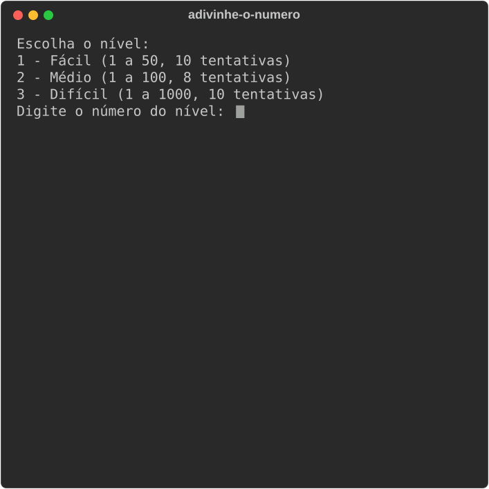

# 🔢 Guess the Number in Python | Programming Logic Exercise

**English** · [Português (Brasil)](README.md)


[](https://github.com/ryanvmorais/aprenda-com-ryan-morais/actions/workflows/ci.yml)


**Run it now:** with [uv](https://docs.astral.sh/uv/) installed, clone the repository and, inside `mini_projetos/adivinhe_o_numero`, run `uv run main.py`.

This folder holds the **Guess the Number game in Python**, designed as study material for beginner developers. The computer draws a number and you try to guess it with the "higher" and "lower" hints, within a limit of tries. The main goal is the hands-on use of **programming fundamentals**: drawing a number with `random`, the `while` loop and validating what is typed in the terminal. The game's on-screen text is in Brazilian Portuguese, and so are the identifiers in the code.

### 🎯 Project goal:

Show the use of **random numbers**, **loops with a stop condition** and **error handling on user input** in Python. It is a practical project for students who want to understand how a program talks to the person at the keyboard without crashing when it gets something unexpected.

---

### 📚 What will you learn from this project?

This exercise was designed to consolidate essential algorithm concepts:

- **Random numbers:** using `random.randint` to draw the secret number within the level's range, with both ends included.
- **Loops:** the `while` loop that runs until the right guess or until the tries run out, with a try counter.
- **Comparison:** the `==`, `<` and `>` operators that decide between the right guess and the "higher" and "lower" hints.
- **Error handling:** `int()` inside `try/except` to reject "abc", "3.5" and an empty Enter without breaking the game.
- **Dictionaries and NamedTuple:** the `NIVEIS` table holds each level's range and limit, and a dictionary holds each level's record in the session.
- **Cross-platform OS interaction:** using `os.system` to detect the operating system (`cls` on Windows or `clear` on Unix/Mac) and keep the terminal interface clean and professional.

---

### 🧠 Implementation Guide (The Logic behind the Code):

For beginners, the biggest challenge is not the syntax but **building the reasoning**. Here is the step-by-step construction of this game:

1. **The level table (dictionary and NamedTuple):** each level (easy, medium and hard) is a `Nivel`, a tuple with a name for each position: the name, the lowest and the highest number and the limit of tries. They live in the `NIVEIS` dictionary, whose key is the menu key (`"1"`, `"2"` or `"3"`). The menu is built by reading this table, and the choice is validated against the same table: a new level is just one more line.
2. **The draw (`random.randint`):** at the start of the match, `random.randint(1, 100)` picks a number from 1 to 100, with both ends included. The number is kept in a variable and only shows up on screen when you guess it or when the tries run out.
3. **The heart of the game (`while` loop):** the match runs in a loop that goes on while there are tries left (`while tentativa <= nivel.limite`). Each turn always follows this order: `ask for the guess` -> `compare it with the drawn number` -> `show the "higher" or "lower" hint` -> `add 1 to the counter`. Got it right? `return` leaves the loop at once. Out of tries? The loop stops by itself and the game reveals the number.
4. **Protection against errors (try/except):** what if the game asks for a number and the user types a letter? `int("abc")` raises an error (`ValueError`) and the program would close with an ugly message. Here `try/except` "tries" to convert the text and, if it fails, politely warns the user and asks again. A guess outside the level's range is rejected too, and no invalid input uses up a try.
5. **Session records (dictionary):** a record is the lowest number of tries in a win. On each win, the game compares the result with the level's record and keeps the best one in a dictionary. When you stop playing, the summary of the three levels shows up. Records last while the game is open.
6. **Keyboard and draw as parameters:** the functions receive what reads the keyboard (`ler`) and what draws the number (`sortear`) as parameters, with `input` and `random.randint` as the defaults. Players notice no difference, but the tests pass a fake keyboard and a fake draw and already know the secret number and what was "typed".

> 💡 **Strategy tip:** always guess the middle of the range that is left (50, then 25 or 75, and so on). Each guess cuts the possibilities in half, and each level's limit of tries was set with this strategy in mind, which is called **binary search**.

---

### 🛠️ Technologies and Tools:

To give you the best learning experience, the project uses the following technologies:

| Tool | Description |
| :--- | :--- |
| **Python 3.12+** | The project's main language. The game uses only the standard library, with no external dependencies. |
| **uv** | Dependency and virtual environment manager: creates the environment and runs the game with a single command. |
| **Terminal** | The interface where the game runs and receives the user's guesses (CMD, PowerShell or the VS Code/PyCharm terminal). |

The quality tools (Ruff, Black, Mypy and Pytest) are in [Quality and tests](#quality-and-tests). For the reasoning behind each choice, see [docs/stack.md](docs/stack.md) (in Portuguese).

---

### ⚙️ How to run the project locally:

**Prerequisites:** [Python 3.12+](https://www.python.org/downloads/) and [uv](https://docs.astral.sh/uv/getting-started/installation/). To check, run `python --version` and `uv --version`.

1.  **Clone the repository:**
    ```bash
    git clone https://github.com/ryanvmorais/aprenda-com-ryan-morais.git
    cd aprenda-com-ryan-morais/mini_projetos/adivinhe_o_numero
    ```
2.  **Run the game:** in the terminal (CMD, PowerShell or the VS Code/PyCharm one), inside the project folder. `uv` creates the virtual environment by itself on the first run.
    ```bash
    uv run main.py
    ```
3.  **Prefer two clicks? Use the shortcut:** on Windows, open `iniciar_jogo.bat`; on Linux/macOS, run `iniciar_jogo.sh` in the terminal. The scripts detect whether you have `uv` (preferred) or `python`/`python3` installed before starting the match.

> ⚠️ **Note:** without `uv`, `python main.py` works just the same, because the game has no external dependencies. The game also detects whether you are on Windows, Linux or macOS to clear the screen the right way. To quit at any moment, press `Ctrl+C`.

---

### Quality and tests

The project has an automated test suite (`pytest`) and a quality gate that runs in CI on every push and every PR:

```bash
# Installs the development dependencies
uv sync

# Lint + import order
uv run ruff check .

# Formatting
uv run black --check .

# Type checking
uv run mypy

# Tests
uv run pytest
```

For the map of each technology in the stack (what it is, why it was chosen, what to study), see [docs/stack.md](docs/stack.md). For the expected behavior of the game and the history of decisions, see [specs/](specs/). For architecture and conventions in detail, see [CLAUDE.md](CLAUDE.md). These three are in Portuguese.

---

### 📋 Practice activities (Evolution Challenges):

To exercise what you learned, try changing the code and implementing these new features:

1. **📜 Guess History:** store each guess of the match in a list and, at the end, show all of them on a single line (`Seus palpites: 50, 25, 37`).
   - **What you learn:** adding one item to the list on each turn of the loop (`append`) and joining the items into a text with `", ".join(...)`.
2. **🔥 "Hot" or "Cold" Hint:** besides "higher" and "lower", warn "🔥 Quente!" (hot) when the wrong guess is within 5 of the drawn number.
   - **What you learn:** measuring the distance between two numbers with `abs()` and fitting one more condition inside the loop.
3. **🎚️ Custom Level:** add option 4 to the menu, which asks the player for the highest number of the range and the limit of tries before the match starts.
   - **What you learn:** creating a `Nivel` while the program runs and reusing the `try/except` validation for numbers the player chose.

---

### 🧭 Keep practicing:

This project is part of a trail of programming logic exercises in Python. After this one, try:

- **[Rock, Paper, Scissors in Python](../pedra_papel_tesoura/README.en.md):** dictionaries and Object-Oriented Programming.
- **[Tic Tac Toe in Python](../jogo_da_velha/README.en.md):** matrices and Object-Oriented Programming.

See all the channel's projects and videos at [aprenda-com-ryan-morais](https://github.com/ryanvmorais/aprenda-com-ryan-morais).

---

### 💡 Any questions or suggestions?

Learning something new has its challenges, but I'm here to walk the path with you! If you found a mistake, had trouble running the game, or thought of an improvement that would make this material even more instructive:

- **Open an [Issue](https://github.com/ryanvmorais/aprenda-com-ryan-morais/issues):** describe your question or suggestion. It is the best way for us to exchange knowledge and help other people who have the same question.
- **Contribute code:** want to propose an improvement? See the step-by-step guide in [CONTRIBUTING.md](CONTRIBUTING.md) (in Portuguese).
- **Email me:** if you prefer something more private, write to [**contato@ryanmorais.com.br**](mailto:contato@ryanmorais.com.br).

I will be very happy to see your progress and get your feedback so we can keep improving our study materials! 🤝

---

### ⚖️ License

This project is under the **MIT License**. That means you can use, copy and modify the code freely, including in your own projects. For more details, see the [LICENSE](LICENSE) file.
