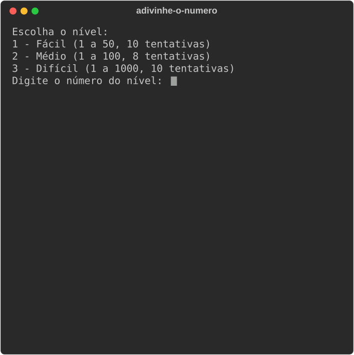

# 🔢 Adivinhe o Número em Python | Exercício de Lógica de Programação

[English](README.en.md) · **Português (Brasil)**


[](https://github.com/ryanvmorais/aprenda-com-ryan-morais/actions/workflows/ci.yml)


**Rodar agora:** com o [uv](https://docs.astral.sh/uv/) instalado, clone o repositório e, dentro de `mini_projetos/adivinhe_o_numero`, rode `uv run main.py`.

Esta pasta contém o jogo **Adivinhe o Número em Python**, projetado como material de estudo para desenvolvedores iniciantes. O computador sorteia um número e você tenta acertá-lo com as dicas "maior" e "menor", dentro de um limite de tentativas. O foco principal é a aplicação prática de **fundamentos da programação**: o sorteio com `random`, o laço `while` e a validação do que é digitado no terminal.

### 🎯 Objetivo do Projeto:

Demonstrar a aplicação de **números aleatórios**, **estruturas de repetição com condição de parada** e **tratamento de erros na entrada do usuário** em Python. É um projeto prático ideal para estudantes que desejam entender como um programa conversa com quem está do outro lado do teclado sem quebrar quando recebe algo inesperado.

---

### 📚 O que você vai aprender com este projeto?

Este exercício foi estruturado para consolidar conceitos essenciais de algoritmos:

- **Números Aleatórios:** uso de `random.randint` para sortear o número secreto dentro da faixa do nível, com os dois extremos incluídos.
- **Estruturas de Repetição:** o laço `while` que roda até o acerto ou até acabarem as tentativas, com um contador de tentativas.
- **Comparação:** os operadores `==`, `<` e `>` que decidem entre o acerto e as dicas "maior" e "menor".
- **Tratamento de Erros:** `int()` dentro de `try/except` para recusar "abc", "3.5" e o Enter vazio sem derrubar o jogo.
- **Dicionários e NamedTuple:** a tabela `NIVEIS` guarda a faixa e o limite de cada nível, e um dicionário guarda o recorde de cada nível na sessão.
- **Interação Multiplataforma com o SO:** uso de `os.system` para detectar o sistema operacional (`cls` no Windows ou `clear` em Unix/Mac) e manter a interface do terminal limpa e profissional.

---

### 🧠 Guia de Implementação (A Lógica por trás do Código):

Para quem está começando, o maior desafio não é a sintaxe, mas a **montagem do raciocínio**. Confira o passo a passo da construção deste jogo:

1. **A Tabela de Níveis (Dicionário e NamedTuple):** cada nível (fácil, médio e difícil) é um `Nivel`, uma tupla com nome em cada posição: o nome, o menor e o maior número e o limite de tentativas. Eles ficam no dicionário `NIVEIS`, cuja chave é a tecla do menu (`"1"`, `"2"` ou `"3"`). O menu é montado lendo essa tabela, e a escolha é validada na mesma tabela: um nível novo é só uma linha a mais.
2. **O Sorteio (`random.randint`):** no começo da partida, `random.randint(1, 100)` escolhe um número de 1 a 100, com os dois extremos incluídos. O número fica guardado numa variável e só aparece na tela quando você acerta ou quando as tentativas acabam.
3. **O Coração do Jogo (Laço `while`):** a partida roda num laço que continua enquanto ainda há tentativas (`while tentativa <= nivel.limite`). A cada volta ela segue sempre esta ordem: `pede o palpite` -> `compara com o número sorteado` -> `mostra a dica "maior" ou "menor"` -> `soma 1 ao contador`. Acertou? O `return` sai do laço na hora. Acabaram as tentativas? O laço para sozinho e o jogo revela o número.
4. **Proteção contra Erros (Try/Except):** e se o jogo pedir um número e o usuário digitar uma letra? `int("abc")` lança um erro (`ValueError`) e o programa fecharia com uma mensagem feia. Aqui o `try/except` "tenta" converter o texto e, se der erro, avisa o usuário educadamente e pede de novo. O palpite fora da faixa do nível também é recusado, e nenhuma entrada inválida gasta tentativa.
5. **Recordes da Sessão (Dicionário):** recorde é o menor número de tentativas numa vitória. A cada acerto, o jogo compara o resultado com o recorde do nível e guarda o melhor num dicionário. Quando você para de jogar, aparece o resumo dos três níveis. Os recordes valem enquanto o jogo está aberto.
6. **Teclado e Sorteio por Parâmetro:** as funções recebem quem lê o teclado (`ler`) e quem sorteia (`sortear`) como parâmetros, com `input` e `random.randint` como padrão. Quem joga não percebe a diferença, mas os testes passam um teclado e um sorteio falsos e já sabem qual é o número secreto e o que foi "digitado".

> 💡 **Dica de estratégia:** chute sempre o meio da faixa que sobrou (50, depois 25 ou 75, e assim por diante). Cada palpite corta as possibilidades pela metade, e os limites de tentativas de cada nível foram pensados a partir dessa estratégia, que se chama **busca binária**.

---

### 🛠️ Tecnologias e Ferramentas:

Para garantir a melhor experiência de aprendizado, o projeto utiliza as seguintes tecnologias:

| Ferramenta | Descrição |
| :--- | :--- |
| **Python 3.12+** | Linguagem principal do projeto. O jogo usa só a biblioteca padrão, sem dependências externas. |
| **uv** | Gerenciador de dependências e ambientes virtuais: cria o ambiente e roda o jogo com um único comando. |
| **Terminal** | Interface onde o jogo roda e recebe os palpites do usuário (CMD, PowerShell ou o terminal do VS Code/PyCharm). |

As ferramentas de qualidade (Ruff, Black, Mypy e Pytest) estão em [Qualidade e testes](#qualidade-e-testes). Para o porquê de cada escolha, veja [docs/stack.md](docs/stack.md).

---

### ⚙️ Como rodar o projeto localmente:

**Pré-requisitos:** [Python 3.12+](https://www.python.org/downloads/) e [uv](https://docs.astral.sh/uv/getting-started/installation/). Para conferir, rode `python --version` e `uv --version`.

1.  **Clone o repositório:**
    ```bash
    git clone https://github.com/ryanvmorais/aprenda-com-ryan-morais.git
    cd aprenda-com-ryan-morais/mini_projetos/adivinhe_o_numero
    ```
2.  **Execute o jogo:** no terminal (CMD, PowerShell ou o do VS Code/PyCharm), dentro da pasta do projeto. O `uv` cria o ambiente virtual sozinho na primeira execução.
    ```bash
    uv run main.py
    ```
3.  **Prefere dois cliques? Use o atalho:** no Windows, abra o `iniciar_jogo.bat`; no Linux/macOS, execute o `iniciar_jogo.sh` no terminal. Os scripts detectam se você tem `uv` (preferido) ou `python`/`python3` instalado antes de iniciar a partida.

> ⚠️ **Nota:** sem o `uv`, `python main.py` funciona igual, porque o jogo não tem nenhuma dependência externa. O jogo também detecta se você está no Windows, Linux ou macOS para limpar a tela do jeito certo. Para sair a qualquer momento, aperte `Ctrl+C`.

---

### Qualidade e testes

O projeto tem uma suíte de testes automatizados (`pytest`) e um portão de qualidade que roda no CI a cada push e a cada PR:

```bash
# Instala as dependências de desenvolvimento
uv sync

# Lint + ordem de imports
uv run ruff check .

# Formatação
uv run black --check .

# Checagem de tipos
uv run mypy

# Testes
uv run pytest
```

Para o mapa de cada tecnologia da stack (o que é, por que foi escolhida, o que estudar), veja [docs/stack.md](docs/stack.md). Para o comportamento esperado do jogo e o histórico de decisões, veja [specs/](specs/). Para o detalhamento de arquitetura e convenções, veja [CLAUDE.md](CLAUDE.md).

---

### 📋 Atividades para praticar (Desafios de Evolução):

Para exercitar o que aprendeu, tente modificar o código e implementar estas novas funcionalidades:

1. **📜 Histórico dos Palpites:** guarde cada palpite da partida numa lista e, no fim, mostre todos eles numa linha só (`Seus palpites: 50, 25, 37`).
   - **O Aprendizado:** acrescentar um item na lista a cada volta do laço (`append`) e juntar os itens num texto com `", ".join(...)`.
2. **🔥 Dica de "Quente" ou "Frio":** além de "maior" e "menor", avise "🔥 Quente!" quando o palpite errado estiver a até 5 números do sorteado.
   - **O Aprendizado:** medir a distância entre dois números com `abs()` e encaixar mais uma condição dentro do laço.
3. **🎚️ Nível Personalizado:** acrescente a opção 4 no menu, que pergunta ao jogador o maior número da faixa e o limite de tentativas antes de começar a partida.
   - **O Aprendizado:** criar um `Nivel` enquanto o programa roda e reaproveitar a validação com `try/except` para números que o próprio jogador escolheu.

---

### 🧭 Continue praticando:

Este projeto faz parte de uma trilha de exercícios de lógica de programação em Python. Depois deste, experimente:

- **[Pedra, Papel e Tesoura em Python](../pedra_papel_tesoura/):** dicionários e Programação Orientada a Objetos.
- **[Jogo da Velha em Python](../jogo_da_velha/):** matrizes e Programação Orientada a Objetos.

Veja todos os projetos e vídeos do canal em [aprenda-com-ryan-morais](https://github.com/ryanvmorais/aprenda-com-ryan-morais).

---

### 💡 Ficou com alguma dúvida ou tem sugestões?

Aprender algo novo tem seus desafios, mas estou aqui para caminharmos juntos! Se você encontrou algum erro, teve dificuldade em rodar o jogo ou pensou numa melhoria que tornaria este material ainda mais didático:

- **Abra uma [Issue](https://github.com/ryanvmorais/aprenda-com-ryan-morais/issues):** descreva sua dúvida ou sugestão. É a melhor forma de trocarmos conhecimento e ajudarmos outras pessoas que tenham a mesma dúvida.
- **Contribua com código:** quer propor uma melhoria? Veja o passo a passo no [CONTRIBUTING.md](CONTRIBUTING.md).
- **Me mande um e-mail:** se preferir algo mais privado, escreva para [**contato@ryanmorais.com.br**](mailto:contato@ryanmorais.com.br).

Ficarei muito feliz em ver seu progresso e receber seu feedback para melhorar cada vez mais nossos materiais de estudo! 🤝

---

### ⚖️ Licença

Este projeto está sob a **Licença MIT**. Isso significa que você pode usar, copiar e modificar o código à vontade, inclusive nos seus projetos. Para mais detalhes, consulte o arquivo [LICENSE](LICENSE).
