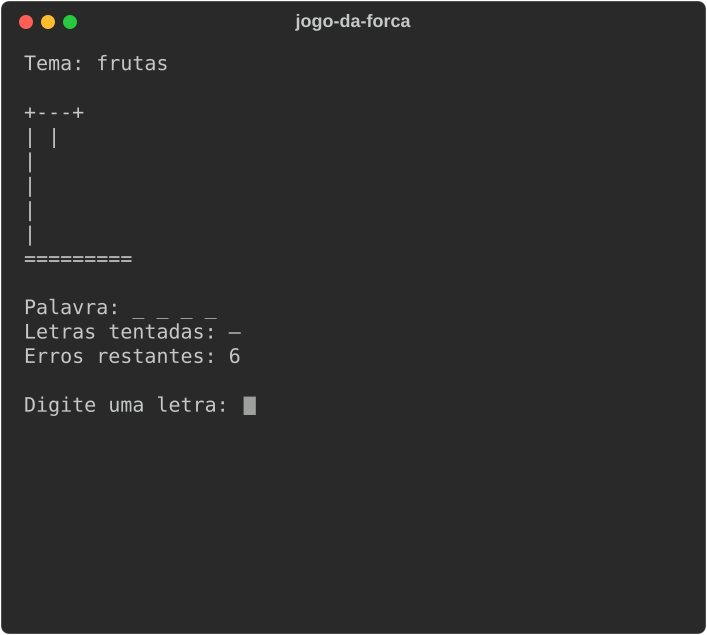

# 🪢 Hangman in Python | Programming Logic Exercise

**English** · [Português (Brasil)](README.md)


[](https://github.com/ryanvmorais/aprenda-com-ryan-morais/actions/workflows/ci.yml)


**Run it now:** with [uv](https://docs.astral.sh/uv/) installed, clone the repository and, inside `mini_projetos/jogo_da_forca`, run `uv run main.py`.

This folder holds the **Hangman game in Python** (Jogo da Forca), designed as study material for beginner developers. The computer draws a Portuguese word, shows its theme as a hint, and you try to find it letter by letter before the hangman drawing is complete. The main goal is the hands-on use of **programming fundamentals**: walking through and building strings, keeping the guessed letters in a set and comparing letters with and without accents. The game's on-screen text and words are in Brazilian Portuguese, and so are the identifiers in the code.

### 🎯 Project goal:

Show the use of **strings**, **sets** and **accent removal with `unicodedata`** in Python. It is a practical project for students who want to understand how a program compares what was typed with the text it keeps, even when one has an accent and the other does not.

---

### 📚 What will you learn from this project?

This exercise was designed to consolidate essential algorithm concepts:

- **Strings:** walking through a word letter by letter, swapping the hidden letters for `_` and joining everything with `" ".join(...)`.
- **Sets:** keeping the guessed letters without repetition, counting the mistakes with the difference `tentadas - letras_da_palavra` and knowing whether the word was found with `issubset`.
- **Accents with `unicodedata`:** the `NFD` form splits each accented letter from its accent mark, so typing "a" reveals the "ã" and typing "c" reveals the "ç".
- **Dictionaries:** the `PALAVRAS` table holds the words of each theme, and the draw picks a (theme, word) pair that has not come up yet in the session.
- **Loops:** the `while` loop that runs until the word is found or the hangman is complete, and the validation that asks for the letter again without counting a mistake.
- **Cross-platform OS interaction:** using `os.system` to detect the operating system (`cls` on Windows or `clear` on Unix/Mac) and keep the terminal interface clean and professional.

---

### 🧠 Implementation Guide (The Logic behind the Code):

For beginners, the biggest challenge is not the syntax but **building the reasoning**. Here is the step-by-step construction of this game:

1. **Words by theme (dictionary):** the `PALAVRAS` dictionary has five themes (fruits, animals, countries, professions and household objects), with eight words each. The words keep their accented spelling ("maçã", "japão"), which is how they show up on screen. A new theme is just one more key in the dictionary.
2. **Drawing without repeats (set):** on each match, the game gathers every (theme, word) pair in a list, removes the ones that already came up and draws one with `random.choice`. The drawn word goes into the `ja_sorteadas` set, and once every word has come up the list starts over.
3. **The letter without its accent (`unicodedata`):** `unicodedata.normalize("NFD", "ç")` splits the letter "c" from the cedilla, and `unicodedata.combining` recognizes the mark so it can be dropped. With that, the game keeps everything without accents: "maçã" becomes the set `{"m", "a", "c"}`, and the typed letter goes through the same cleanup before being compared.
4. **The heart of the game (`while` loop):** the match runs while there are mistakes left and the word has not been found. Each turn always follows this order: `clear the screen` -> `draw the hangman and the word` -> `read the letter` -> `check the input` -> `add the letter to the set`. The word is built from the guessed letters: a guessed one shows up with its original spelling ("Ã", "Ç"), one not guessed yet shows up as `_`.
5. **Protection against errors (validated input):** what if the player types "ab", "7" or a letter already guessed? The `conferir_entrada` function rejects it and explains why, and the rejection does not count as a mistake. Notice that the length is checked before `in`: with strings, `"ab" in "abc...z"` is `True`, because `in` looks for a substring, not a character.
6. **The drawing and the score (list and dictionary):** the `FORCA` list has seven drawings, from the empty gallows (zero mistakes) to the complete hangman (six mistakes), and the number of mistakes is the drawing's position in the list. A dictionary keeps the wins and losses, shown when you stop playing.
7. **Keyboard and draw as parameters:** the functions receive what reads the keyboard (`ler`) and what draws the word (`sortear`) as parameters, with `input` and `random.choice` as the defaults. Players notice no difference, but the tests pass a fake keyboard and a fake draw and already know the word and what was "typed".

> 💡 **Strategy tip:** start with the vowels (A, E, O) and then try the most common consonants in Portuguese, such as R, S and M. Vowels show up in almost every word and reveal its shape early on.

---

### 🛠️ Technologies and Tools:

To give you the best learning experience, the project uses the following technologies:

| Tool | Description |
| :--- | :--- |
| **Python 3.12+** | The project's main language. The game uses only the standard library, with no external dependencies. |
| **uv** | Dependency and virtual environment manager: creates the environment and runs the game with a single command. |
| **Terminal** | The interface where the game runs and receives the user's letters (CMD, PowerShell or the VS Code/PyCharm terminal). |

The quality tools (Ruff, Black, Mypy and Pytest) are in [Quality and tests](#quality-and-tests). For the reasoning behind each choice, see [docs/stack.md](docs/stack.md) (in Portuguese).

---

### ⚙️ How to run the project locally:

**Prerequisites:** [Python 3.12+](https://www.python.org/downloads/) and [uv](https://docs.astral.sh/uv/getting-started/installation/). To check, run `python --version` and `uv --version`.

1.  **Clone the repository:**
    ```bash
    git clone https://github.com/ryanvmorais/aprenda-com-ryan-morais.git
    cd aprenda-com-ryan-morais/mini_projetos/jogo_da_forca
    ```
2.  **Run the game:** in the terminal (CMD, PowerShell or the VS Code/PyCharm one), inside the project folder. `uv` creates the virtual environment by itself on the first run.
    ```bash
    uv run main.py
    ```
3.  **Prefer two clicks? Use the shortcut:** on Windows, open `iniciar_jogo.bat`; on Linux/macOS, run `iniciar_jogo.sh` in the terminal. The scripts detect whether you have `uv` (preferred) or `python`/`python3` installed before starting the match.

> ⚠️ **Note:** without `uv`, `python main.py` works just the same, because the game has no external dependencies. The game also detects whether you are on Windows, Linux or macOS to clear the screen the right way. To quit at any moment, press `Ctrl+C`.

---

### Quality and tests

The project has an automated test suite (`pytest`) and a quality gate that runs in CI on every push and every PR:

```bash
# Installs the development dependencies
uv sync

# Lint + import order
uv run ruff check .

# Formatting
uv run black --check .

# Type checking
uv run mypy

# Tests
uv run pytest
```

For the map of each technology in the stack (what it is, why it was chosen, what to study), see [docs/stack.md](docs/stack.md). For the expected behavior of the game and the history of decisions, see [specs/](specs/). For architecture and conventions in detail, see [CLAUDE.md](CLAUDE.md). These three are in Portuguese.

---

### 📋 Practice activities (Evolution Challenges):

To exercise what you learned, try changing the code and implementing these new features:

1. **💡 Ask for a Hint:** when the player types `?`, reveal one of the missing letters, drawn among them, and count the hint as a mistake.
   - **What you learn:** finding the missing letters with a set difference (`letras_da_palavra - tentadas`) and drawing one of them with `random.choice(sorted(...))`.
2. **🗂️ Choose the Theme:** before each match, show a numbered menu with the themes and draw the word only among the ones of the chosen theme.
   - **What you learn:** building the menu by walking through the dictionary keys with `enumerate` and validating the choice before drawing.
3. **🔗 Compound Words:** accept words with a hyphen or a space, such as "guarda-chuva" (umbrella) and "pão de queijo" (cheese bread), showing the hyphen and the space from the start, with no `_` in their place.
   - **What you learn:** telling letters apart from everything else with `str.isalpha()`, both when masking the word and when building the set of letters.

---

### 🧭 Keep practicing:

This project is part of a trail of programming logic exercises in Python. After this one, try:

- **[Rock, Paper, Scissors in Python](../pedra_papel_tesoura/README.en.md):** dictionaries and Object-Oriented Programming.
- **[Tic Tac Toe in Python](../jogo_da_velha/README.en.md):** matrices and Object-Oriented Programming.

See all the channel's projects and videos at [aprenda-com-ryan-morais](https://github.com/ryanvmorais/aprenda-com-ryan-morais).

---

### 💡 Any questions or suggestions?

Learning something new has its challenges, but I'm here to walk the path with you! If you found a mistake, had trouble running the game, or thought of an improvement that would make this material even more instructive:

- **Open an [Issue](https://github.com/ryanvmorais/aprenda-com-ryan-morais/issues):** describe your question or suggestion. It is the best way for us to exchange knowledge and help other people who have the same question.
- **Contribute code:** want to propose an improvement? See the step-by-step guide in [CONTRIBUTING.md](CONTRIBUTING.md) (in Portuguese).
- **Email me:** if you prefer something more private, write to [**contato@ryanmorais.com.br**](mailto:contato@ryanmorais.com.br).

I will be very happy to see your progress and get your feedback so we can keep improving our study materials! 🤝

---

### ⚖️ License

This project is under the **MIT License**. That means you can use, copy and modify the code freely, including in your own projects. For more details, see the [LICENSE](LICENSE) file.
