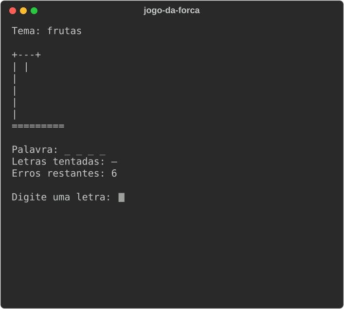

# 🪢 Jogo da Forca em Python | Exercício de Lógica de Programação

[English](README.en.md) · **Português (Brasil)**


[](https://github.com/ryanvmorais/aprenda-com-ryan-morais/actions/workflows/ci.yml)


**Rodar agora:** com o [uv](https://docs.astral.sh/uv/) instalado, clone o repositório e, dentro de `mini_projetos/jogo_da_forca`, rode `uv run main.py`.

Esta pasta contém o **Jogo da Forca em Python**, projetado como material de estudo para desenvolvedores iniciantes. O computador sorteia uma palavra em português, mostra o tema dela como dica, e você tenta descobri-la letra por letra antes que o desenho da forca se complete. O foco principal é a aplicação prática de **fundamentos da programação**: percorrer e montar strings, guardar as letras tentadas num conjunto (`set`) e comparar letras com e sem acento.

### 🎯 Objetivo do Projeto:

Demonstrar a aplicação de **strings**, **conjuntos** e **remoção de acentos com `unicodedata`** em Python. É um projeto prático ideal para estudantes que desejam entender como um programa compara o que foi digitado com o texto que ele guarda, mesmo quando um tem acento e o outro não.

---

### 📚 O que você vai aprender com este projeto?

Este exercício foi estruturado para consolidar conceitos essenciais de algoritmos:

- **Strings:** percorrer uma palavra letra por letra, trocar as letras escondidas por `_` e juntar tudo com `" ".join(...)`.
- **Conjuntos (`set`):** guardar as letras tentadas sem repetição, contar os erros com a diferença `tentadas - letras_da_palavra` e saber se a palavra foi descoberta com `issubset`.
- **Acentos com `unicodedata`:** a forma `NFD` separa cada letra acentuada da marca do acento, para que digitar "a" revele o "ã" e digitar "c" revele o "ç".
- **Dicionários:** a tabela `PALAVRAS` guarda as palavras de cada tema, e o sorteio escolhe um par (tema, palavra) que ainda não saiu na sessão.
- **Estruturas de Repetição:** o laço `while` que roda até a palavra ser descoberta ou a forca se completar, e a validação que pede a letra de novo sem contar erro.
- **Interação Multiplataforma com o SO:** uso de `os.system` para detectar o sistema operacional (`cls` no Windows ou `clear` em Unix/Mac) e manter a interface do terminal limpa e profissional.

---

### 🧠 Guia de Implementação (A Lógica por trás do Código):

Para quem está começando, o maior desafio não é a sintaxe, mas a **montagem do raciocínio**. Confira o passo a passo da construção deste jogo:

1. **As Palavras por Tema (Dicionário):** o dicionário `PALAVRAS` tem cinco temas (frutas, animais, países, profissões e objetos da casa), com oito palavras cada. As palavras ficam com a grafia acentuada ("maçã", "japão"), que é como aparecem na tela. Um tema novo é só mais uma chave no dicionário.
2. **O Sorteio sem Repetir (Conjunto):** a cada partida, o jogo junta todos os pares (tema, palavra) numa lista, tira os que já saíram e sorteia um com `random.choice`. A palavra sorteada entra no conjunto `ja_sorteadas`, e quando todas já saíram a lista recomeça.
3. **A Letra sem Acento (`unicodedata`):** `unicodedata.normalize("NFD", "ç")` separa a letra "c" da cedilha, e `unicodedata.combining` reconhece a marca para descartá-la. Com isso, o jogo guarda tudo sem acento: "maçã" vira o conjunto `{"m", "a", "c"}`, e a letra digitada passa pela mesma limpeza antes de ser comparada.
4. **O Coração do Jogo (Laço `while`):** a partida roda enquanto há erros sobrando e a palavra não foi descoberta. A cada volta ela segue sempre esta ordem: `limpa a tela` -> `desenha a forca e a palavra` -> `lê a letra` -> `confere a entrada` -> `guarda a letra no conjunto`. A palavra aparece montada a partir das letras tentadas: quem já foi tentada aparece com a grafia original ("Ã", "Ç"), quem não foi aparece como `_`.
5. **Proteção contra Erros (Entrada Validada):** e se o jogador digitar "ab", "7" ou uma letra que já tentou? A função `conferir_entrada` recusa e explica o motivo, e a recusa não conta como erro. Repare que o tamanho é conferido antes do `in`: com strings, `"ab" in "abc...z"` dá `True`, porque o `in` procura um trecho, e não um caractere.
6. **O Desenho e o Placar (Lista e Dicionário):** a lista `FORCA` tem sete desenhos, do poste vazio (zero erros) à forca completa (seis erros), e o número de erros é a posição do desenho na lista. Um dicionário guarda as vitórias e as derrotas, mostradas quando você para de jogar.
7. **Teclado e Sorteio por Parâmetro:** as funções recebem quem lê o teclado (`ler`) e quem sorteia (`sortear`) como parâmetros, com `input` e `random.choice` como padrão. Quem joga não percebe a diferença, mas os testes passam um teclado e um sorteio falsos e já sabem qual é a palavra e o que foi "digitado".

> 💡 **Dica de estratégia:** comece pelas vogais (A, E, O) e depois tente as consoantes mais comuns do português, como R, S e M. As vogais aparecem em quase toda palavra e revelam o formato dela logo no começo.

---

### 🛠️ Tecnologias e Ferramentas:

Para garantir a melhor experiência de aprendizado, o projeto utiliza as seguintes tecnologias:

| Ferramenta | Descrição |
| :--- | :--- |
| **Python 3.12+** | Linguagem principal do projeto. O jogo usa só a biblioteca padrão, sem dependências externas. |
| **uv** | Gerenciador de dependências e ambientes virtuais: cria o ambiente e roda o jogo com um único comando. |
| **Terminal** | Interface onde o jogo roda e recebe as letras do usuário (CMD, PowerShell ou o terminal do VS Code/PyCharm). |

As ferramentas de qualidade (Ruff, Black, Mypy e Pytest) estão em [Qualidade e testes](#qualidade-e-testes). Para o porquê de cada escolha, veja [docs/stack.md](docs/stack.md).

---

### ⚙️ Como rodar o projeto localmente:

**Pré-requisitos:** [Python 3.12+](https://www.python.org/downloads/) e [uv](https://docs.astral.sh/uv/getting-started/installation/). Para conferir, rode `python --version` e `uv --version`.

1.  **Clone o repositório:**
    ```bash
    git clone https://github.com/ryanvmorais/aprenda-com-ryan-morais.git
    cd aprenda-com-ryan-morais/mini_projetos/jogo_da_forca
    ```
2.  **Execute o jogo:** no terminal (CMD, PowerShell ou o do VS Code/PyCharm), dentro da pasta do projeto. O `uv` cria o ambiente virtual sozinho na primeira execução.
    ```bash
    uv run main.py
    ```
3.  **Prefere dois cliques? Use o atalho:** no Windows, abra o `iniciar_jogo.bat`; no Linux/macOS, execute o `iniciar_jogo.sh` no terminal. Os scripts detectam se você tem `uv` (preferido) ou `python`/`python3` instalado antes de iniciar a partida.

> ⚠️ **Nota:** sem o `uv`, `python main.py` funciona igual, porque o jogo não tem nenhuma dependência externa. O jogo também detecta se você está no Windows, Linux ou macOS para limpar a tela do jeito certo. Para sair a qualquer momento, aperte `Ctrl+C`.

---

### Qualidade e testes

O projeto tem uma suíte de testes automatizados (`pytest`) e um portão de qualidade que roda no CI a cada push e a cada PR:

```bash
# Instala as dependências de desenvolvimento
uv sync

# Lint + ordem de imports
uv run ruff check .

# Formatação
uv run black --check .

# Checagem de tipos
uv run mypy

# Testes
uv run pytest
```

Para o mapa de cada tecnologia da stack (o que é, por que foi escolhida, o que estudar), veja [docs/stack.md](docs/stack.md). Para o comportamento esperado do jogo e o histórico de decisões, veja [specs/](specs/). Para o detalhamento de arquitetura e convenções, veja [CLAUDE.md](CLAUDE.md).

---

### 📋 Atividades para praticar (Desafios de Evolução):

Para exercitar o que aprendeu, tente modificar o código e implementar estas novas funcionalidades:

1. **💡 Pedir uma Dica:** quando o jogador digitar `?`, revele uma das letras que faltam, sorteada entre elas, e conte a dica como um erro.
   - **O Aprendizado:** achar as letras que faltam com a diferença de conjuntos (`letras_da_palavra - tentadas`) e sortear uma delas com `random.choice(sorted(...))`.
2. **🗂️ Escolher o Tema:** antes de cada partida, mostre um menu numerado com os temas e sorteie a palavra só entre as do tema escolhido.
   - **O Aprendizado:** montar o menu percorrendo as chaves do dicionário com `enumerate` e validar a escolha antes de sortear.
3. **🔗 Palavras Compostas:** aceite palavras com hífen ou espaço, como "guarda-chuva" e "pão de queijo", mostrando o hífen e o espaço desde o começo, sem `_` no lugar deles.
   - **O Aprendizado:** separar o que é letra do que não é com `str.isalpha()`, tanto na hora de mascarar a palavra quanto na de montar o conjunto de letras.

---

### 🧭 Continue praticando:

Este projeto faz parte de uma trilha de exercícios de lógica de programação em Python. Depois deste, experimente:

- **[Pedra, Papel e Tesoura em Python](../pedra_papel_tesoura/):** dicionários e Programação Orientada a Objetos.
- **[Jogo da Velha em Python](../jogo_da_velha/):** matrizes e Programação Orientada a Objetos.

Veja todos os projetos e vídeos do canal em [aprenda-com-ryan-morais](https://github.com/ryanvmorais/aprenda-com-ryan-morais).

---

### 💡 Ficou com alguma dúvida ou tem sugestões?

Aprender algo novo tem seus desafios, mas estou aqui para caminharmos juntos! Se você encontrou algum erro, teve dificuldade em rodar o jogo ou pensou numa melhoria que tornaria este material ainda mais didático:

- **Abra uma [Issue](https://github.com/ryanvmorais/aprenda-com-ryan-morais/issues):** descreva sua dúvida ou sugestão. É a melhor forma de trocarmos conhecimento e ajudarmos outras pessoas que tenham a mesma dúvida.
- **Contribua com código:** quer propor uma melhoria? Veja o passo a passo no [CONTRIBUTING.md](../../CONTRIBUTING.md) do repositório. Neste projeto, mantenha as funções pequenas, com o teclado (`ler`) e o sorteio (`sortear`) entrando por parâmetro, para os testes não dependerem do teclado nem da sorte.
- **Me mande um e-mail:** se preferir algo mais privado, escreva para [**contato@ryanmorais.com.br**](mailto:contato@ryanmorais.com.br).

Ficarei muito feliz em ver seu progresso e receber seu feedback para melhorar cada vez mais nossos materiais de estudo! 🤝

---

### ⚖️ Licença

Este projeto está sob a **Licença MIT**. Isso significa que você pode usar, copiar e modificar o código à vontade, inclusive nos seus projetos. Para mais detalhes, consulte o arquivo [LICENSE](LICENSE).
