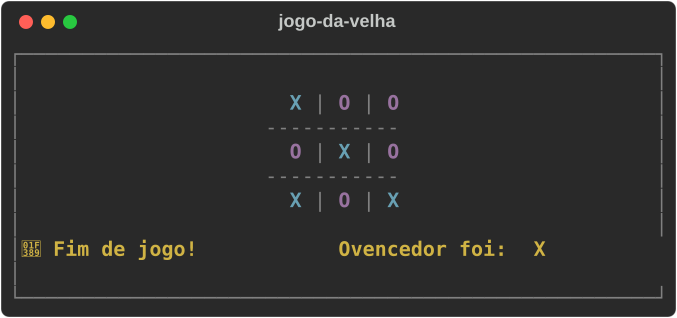

# ⭕ Tic Tac Toe in Python | Programming Logic Exercise

**English** · [Português (Brasil)](README.md)


[](https://github.com/ryanvmorais/aprenda-com-ryan-morais/actions/workflows/ci.yml)


This folder holds a **Tic Tac Toe game (Jogo da Velha) in Python**, designed as study material for beginner developers. The main goal is the hands-on use of **programming fundamentals** and matrix handling in the terminal. The game's on-screen text is in Brazilian Portuguese, and so are the identifiers in the code.

### 🎯 Project goal:

Show the use of **loops**, **conditional statements** and **Object-Oriented Programming (OOP)** in Python. It is a practical project for students who want to consolidate the logical reasoning behind building systems.

---

### 📚 What will you learn from this project?

This exercise was designed to consolidate essential algorithm concepts:

- **Loops:** controlling turns and checking for a win (`while` and `for` loops).
- **Conditional statements:** validating moves and game rules (`if/elif/else`).
- **Matrix handling:** how to manage data using `[row][column]` indexes.
- **OOP (Object-Oriented Programming):** organizing modular, clean and reusable code.
- **Cross-platform OS interaction:** using the `os` module (`os.system` together with `os.name`) to detect the operating system at run time and run the right screen-clearing command (`cls` on Windows or `clear` on Unix/Mac systems).

---

### 🧠 Implementation Guide (The Logic behind the Code):

For beginners, the biggest challenge is not the syntax but **building the reasoning**. Here is the step-by-step construction of this game:

1. **Abstraction and modeling:** picture the board as a 3x3 matrix. In Python we use a **list of lists** to represent it, which lets us reach each square through coordinates such as `tabuleiro[0][1]`.
2. **UX and game flow:** the game works in cycles. The user interacts through the terminal, the system validates the move and uses `os.system` to clear the screen, giving the feel of a dynamic, tidy application.
3. **Architecture with OOP:** we use **Object-Oriented Programming (OOP)** to organize the code. The `JogoDaVelha` class centralizes all the logic and stores the match "state" (who won, whose turn it is and what the board looks like).
4. **Initialization:** every start (or restart) of a match clears the control variables and builds a new board filled only with empty spaces (`' '`).
5. **Win algorithm:** we developed a mathematical logic that scans the **8 winning possibilities**: 3 rows, 3 columns and 2 diagonals. If three equal symbols are found in a row, the game identifies the winner.
6. **The "game loop":** the heart of the project is the `main()` function. It conducts the orchestra: `draw the board` -> `process the user's move` -> `check for a win` -> `process the machine's random move` -> `check for a win` -> `repeat`.
7. **Error handling:** we use `try/except` blocks so the program does not break if the user types something unexpected (such as letters instead of numbers), ensuring a stable experience.

---

### 🛠️ Technologies and Tools:

To give you the best learning experience, the project uses the following technologies:

| Tool | Description |
| :--- | :--- |
| **Python 3.12+** | The project's main language. The game uses only the standard library, with no external dependencies. |
| **uv** | Dependency and virtual environment manager: creates the environment and runs the game with a single command. |
| **Terminal** | The interface where the game runs and receives the user's moves (CMD, PowerShell or the VS Code/PyCharm terminal). |

The quality tools (Ruff, Black, Mypy and Pytest) are in [Quality and tests](#quality-and-tests). For the reasoning behind each choice, see [docs/stack.md](docs/stack.md) (in Portuguese).

---

### ⚙️ How to run the project locally:

**Prerequisites:** [Python 3.12+](https://www.python.org/downloads/) and [uv](https://docs.astral.sh/uv/getting-started/installation/). To check, run `python --version` and `uv --version`.

1.  **Clone the repository:**
    ```bash
    git clone https://github.com/ryanvmorais/aprenda-com-ryan-morais.git
    cd aprenda-com-ryan-morais/mini_projetos/jogo_da_velha
    ```
2.  **Run the game:** in the terminal (CMD, PowerShell or the VS Code/PyCharm one), inside the project folder. `uv` creates the virtual environment by itself on the first run.
    ```bash
    uv run main.py
    ```
3.  **Prefer two clicks? Use the shortcut:** on Windows, open `iniciar_jogo.bat`; on Linux/macOS, run `iniciar_jogo.sh` in the terminal. The scripts detect whether you have `uv` (preferred) or `python`/`python3` installed before starting the match.

> ⚠️ **Note:** without `uv`, `python main.py` works just the same, because the game has no external dependencies. The game also detects whether you are on Windows, Linux or macOS to clear the screen the right way.

---

### Quality and tests

The project has an automated test suite (`pytest`) and a quality gate that runs in CI on every push and every PR:

```bash
# Installs the development dependencies
uv sync

# Lint + import order
uv run ruff check .

# Formatting
uv run black --check .

# Type checking
uv run mypy

# Tests
uv run pytest
```

For the map of each technology in the stack (what it is, why it was chosen, what to study), see [docs/stack.md](docs/stack.md). For the expected behavior of the game and the history of decisions, see [specs/](specs/). For architecture and conventions in detail, see [CLAUDE.md](CLAUDE.md). These three are in Portuguese.

---

### 📋 Practice activities (Evolution Challenges):

To exercise what you learned, try changing the code and implementing these new features:

1. **🏆 Running Scoreboard:** create a counter that does not reset when a match restarts. Add control variables (e.g. `vitorias_x` and `vitorias_o`) that persist while the program is open: every time a winner is detected, update the scoreboard and show it on the next turn.
   - **What you learn:** telling variables that control the **round** apart from those that control the **player's history**, keeping data consistent in applications with several execution cycles.
2. **🤖 Single Player Mode:** make the machine block your moves instead of just playing at random.
   - **What you learn:** turning a strategy rule ("if the opponent is about to win, block") into conditions over the 8 winning lines you already scan in the code.
3. **🎨 Terminal Colors:** use the `colorama` library to color the **"X"** red and the **"O"** blue.
   - **What you learn:** installing an external dependency with `uv add` and using it without breaking the rest of the program.

---

### 🧭 Keep practicing:

This project is part of a trail of programming logic exercises in Python. After this one, try:

- **[Snake Game in Python](../jogo_da_cobrinha/README.en.md):** dynamic lists and a game loop with `curses`.
- **[Dynamic Portfolio with Django](https://github.com/ryanvmorais/django-fullstack-portfolio):** the first step outside the terminal, with advanced security and query optimization.

See all the channel's projects and videos at [aprenda-com-ryan-morais](https://github.com/ryanvmorais/aprenda-com-ryan-morais).

---

### 💡 Any questions or suggestions?

Learning something new has its challenges, but I'm here to walk the path with you! If you found a mistake, had trouble running the game, or thought of an improvement that would make this material even more instructive:

- **Open an [Issue](https://github.com/ryanvmorais/aprenda-com-ryan-morais/issues):** describe your question or suggestion. It is the best way for us to exchange knowledge and help other people who have the same question.
- **Contribute code:** want to propose an improvement? See the step-by-step guide in [CONTRIBUTING.md](CONTRIBUTING.md) (in Portuguese).
- **Email me:** if you prefer something more private, write to [**contato@ryanmorais.com.br**](mailto:contato@ryanmorais.com.br).

I will be very happy to see your progress and get your feedback so we can keep improving our study materials! 🤝

---

### ⚖️ License

This project is under the **MIT License**. That means you can use, copy and modify the code freely, including in your own projects. For more details, see the [LICENSE](LICENSE) file.
